# SEG DATABASE FOUNDATION DRY-RUN ERD v1.0

**Mode:** `CONCEPTUAL / DRY-RUN / NOT IMPLEMENTED`  
**Status:** `DESIGN_EVIDENCE_READY_FOR_REVIEW`

## Purpose

This document is the logical ERD companion to `SEG_DATABASE_FOUNDATION_DRY_RUN_DESIGN_PACKAGE_V1_0.md`. It is not executable DDL, a migration, or an authorization to create database objects. The names are proposed logical entities only.

## Logical relationship diagram

```mermaid
erDiagram
    SOURCES ||--|{ SOURCE_ARTIFACTS : contains
    SOURCE_ARTIFACTS ||--o{ SOURCE_LINEAGE_RELATIONS : parent_or_child
    SOURCES ||--o{ CONTENT_SOURCE_RELATIONS : evidence_for
    SOURCE_ARTIFACTS ||--o{ CONTENT_SOURCE_RELATIONS : locator_for
    CONTENT_RECORDS ||--|{ CONTENT_SOURCE_RELATIONS : supported_by
    CONTENT_RECORDS ||--|| CONTENT_VERSION_STATES : has_current_version
    CONTENT_RECORDS ||--|{ CONTENT_REFERENCE_RELATIONS : cites
    CONTENT_RECORDS ||--|{ CONTENT_TAXONOMY_SCOPES : scoped_to
    PROFESSIONAL_TRACKS ||--o{ CONTENT_TAXONOMY_SCOPES : governs
    CONTENT_RECORDS ||--|| CONTENT_TYPE_PAYLOADS : has_payload_boundary
    CONTENT_TYPE_PAYLOADS ||--o| LESSON_RECORDS : lesson_payload
    CONTENT_TYPE_PAYLOADS ||--o| QUESTION_BANK_RECORDS : question_bank_payload
    CONTENT_TYPE_PAYLOADS ||--o| BOOK_RECORDS : book_payload
    CONTENT_TYPE_PAYLOADS ||--o| CLINICAL_CASE_RECORDS : case_payload
    CONTENT_TYPE_PAYLOADS ||--o| CLINICAL_SKILL_RECORDS : skill_payload
    CONTENT_RECORDS ||--o{ CONTENT_REVIEW_QUEUE : reviewed_through
    CONTENT_REVIEW_QUEUE ||--|{ CONTENT_REVIEW_EVENTS : records
    CONTENT_RECORDS ||--|{ CONTENT_REVIEW_STATES : has_review_state
    CONTENT_RECORDS ||--|{ CONTENT_RIGHTS_STATES : has_rights_state
    SOURCE_ARTIFACTS ||--o{ RIGHTS_RECORDS : rights_evidence
    CONTENT_RECORDS ||--|{ CONTENT_AUDIT_EVENTS : audited_by
    ATLAS_ASSETS ||--o{ ATLAS_ASSET_RELATIONS : related_through
    CONTENT_RECORDS ||--o{ ATLAS_ASSET_RELATIONS : uses
    CONTENT_RECORDS ||--|| CONTENT_PUBLICATION_STATES : has_publication_state
```

## Cardinality notes

| Relation | Logical cardinality | Safety interpretation |
|---|---|---|
| `sources` → `source_artifacts` | One-to-many | A logical source may have TXT, PDF, DOCX, or other representations; representations are not merged automatically. |
| `source_artifacts` ↔ `source_lineage_relations` | Many-to-many through relation rows | Duplicate, derived, related, and replacement claims require evidence and review state. |
| `content_records` → `content_source_relations` | One-to-many | A record may use multiple evidence links; one primary relation requires governed assignment. |
| `content_records` → `content_version_states` | One current state plus history | Exact checksum and unresolved version/edition state must be retained. |
| `content_records` → `content_reference_relations` | One-to-many | Every record must preserve at least one reference/locator according to v1.1. |
| `content_records` → type payload | One-to-one by `content_type` | Exactly one supported type boundary is selected; case/skill conditional payload rules remain intact. |
| `content_records` → review/rights/audit | One-to-many | Independent review dimensions and append-only events must not be collapsed. |
| `content_records` ↔ `professional_tracks` | Many-to-many through scope rows | Explicit pathway scope prevents silent Internship/Resident mixing. |
| `content_records` ↔ `atlas_assets` | Many-to-many through relation rows | Asset rights and medical review remain independent from content approval. |

## Identity boundary

The ERD deliberately separates `source_id`, `artifact_id`, candidate identity, and `record_id`. No legacy-to-record bridge is created. No title, topic, filename, or checksum alone establishes an identity link or authorizes a merge.

## Clinical Case decision

`CLINICAL_CASE_RECORDS` remains in the logical ERD because `clinical_case` is present in the canonical v1.1 enum. The evidence phrase `NOT_SUPPORTED` is preserved as an unresolved implementation interpretation; it does not remove the contract type and does not authorize case records.

## Non-actions

No SQL, migration, table, foreign key, index, policy, record, content import, Atlas relation, clinical approval, rights approval, or activation was performed.

## References

[1]: file:///home/ubuntu/seg-manus-status/schemas/SEG_CONTENT_RECORD_V1_1/SEG_CONTENT_RECORD_V1_1.schema.json "SEG_CONTENT_RECORD_V1_1 canonical additive profile"

[2]: file:///home/ubuntu/seg-internship-output/SEG_DATABASE_FOUNDATION_DRY_RUN_DESIGN_PACKAGE_V1_0.md "SEG Database Foundation DRY-RUN Design Package v1.0"
